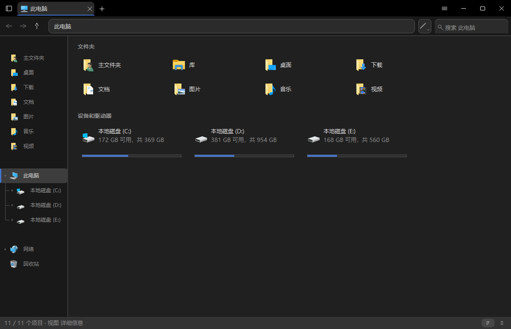
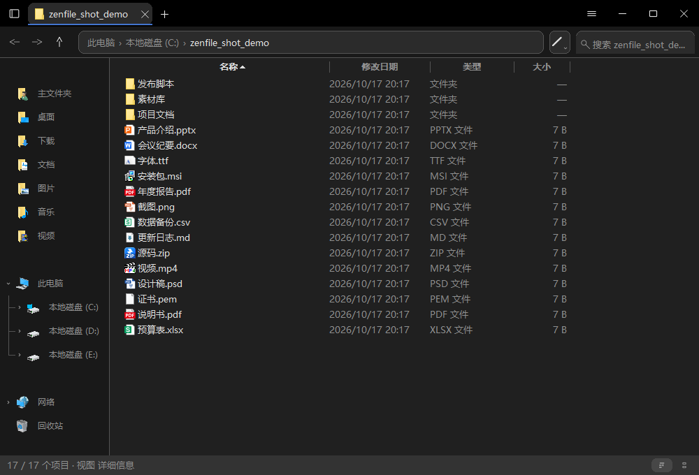

# ZenFile

> **原生 · 轻量 · 性能 · 拓展 · 个性化**

ZenFile 是一款面向 Windows 10/11 x64 的原生文件管理器，界面基于 Win32 与 GDI 完全自绘，
不依赖 WebView2、Node.js 或 .NET 运行时。主程序为 1.48 MiB 的单文件可执行文件。
项目受 [LiteLoaderQQNT](https://github.com/LiteLoaderQQNT/LiteLoaderQQNT) 启发，
其设计取向是：原生程序同样可以兼顾资源占用与界面表现力。



---

## 概述

ZenFile 从零实现了 Win32 消息循环与 GDI 渲染流程，具备以下技术特征：

- 不引入 Electron、Qt 或 WebView2 等运行时，空闲状态常驻内存为 **29.5 MB**
- 右键菜单、属性页、进度窗口等界面元素均为自绘实现，未使用系统控件封装
- 界面布局、圆角样式、菜单条目与图标主题均可配置，并支持实时预览
- 插件以独立进程方式运行，插件故障不影响文件管理器主体



---

## 获取与安装

项目提供两种分发形态，均位于发布页的 Releases 目录。

### 安装版

`ZenFile-setup-<版本号>.exe` 为单文件自解压安装包。执行后默认安装至
`%LOCALAPPDATA%\Programs\ZenFile`，并创建桌面与开始菜单快捷方式。
可通过命令行参数指定安装路径：

```bash
ZenFile-setup-0.3-Beta-Weekly26-10-17.exe "D:\Applications\ZenFile"
```

### 便携版

`ZenFile-portable-<版本号>.zip` 解压后即可运行，无需安装。程序将配置写入
`%APPDATA%\ZenFile\`，插件目录位于可执行文件同级的 `plugins/`，
因此整个解压目录可整体复制或移动。

### 源码构建

```bash
cargo build --release          # 产出 target/release/ZenFile.exe
cargo test -p zenfile-core     # 内核单元测试（70 项）
```

构建要求 Rust 1.85 及以上版本（`rust-toolchain` 指定 stable msvc 目标）。

### 命令行参数

| 参数 | 说明 |
|---|---|
| `--selftest` | 执行无界面自检，全部通过时返回 0 |
| `--version` | 输出版本号与协议版本 |
| `--tray` | 以托盘模式启动 |
| `--new-process` | 强制创建新进程，不占用单实例互斥量 |
| `--plugin <id>` | 以插件进程身份启动，由宿主调用 |
| `--anim-trace <ms>` | 将帧链路埋点记录至 `%TEMP%` 目录下的 CSV |

---

## 架构

```
.
├── crates/
│   ├── zenfile-core/     领域层，不依赖任何 UI 框架
│   │   ├── engine        目录枚举（FindFirstFileExW + 大目录取回优化）
│   │   ├── watch         ReadDirectoryChangesW 增量刷新（仅当前可见目录）
│   │   ├── transfer      自研传输引擎（见下）
│   │   ├── index         文件名索引
│   │   ├── clipboard     CF_HDROP 与资源管理器双向互通
│   │   ├── recycle       直接解析 $Recycle.Bin，不经由 COM
│   │   ├── drives        驱动器清单（Win32 直呼，不使用 WMI）
│   │   ├── network       网络驱动器与共享（MPR WNet* 系列）
│   │   ├── bulk          批量重命名规则（纯函数，不访问磁盘）
│   │   ├── plugin/ipc    插件运行时与帧协议
│   │   └── …             config/paths/hotkey/natural/columns/acl/ops…
│   ├── zenfile-app/      Win32 + GDI 自绘界面 → ZenFile.exe
│   └── zenfile-taskmgr/  任务管理模块
```

`zenfile-core` 不依赖 UI 框架是一项硬性约束，确保更换渲染后端时内核代码无需修改。

---

## 功能

**文件操作**　复制、剪切、粘贴、删除（回收站或永久）、重命名、批量重命名
（5 种规则：查找替换、添加前缀、添加后缀、名称附加序号、删除字符）、新建、属性

**浏览**　4 种视图（大图标、列表、详细信息、中图标），4 种排序方式（名称、大小、
修改时间、类型），自然排序（`file2` 排在 `file10` 之前），标签页与可拖拽分栏，
驱动器、网络位置、回收站、最近访问记录

**查找**　文件名索引检索，并支持以下查询语法：
`report`、`"年度 报告"`、`a OR b`、`-草稿`、`*.txt`、`ext:txt`、`kind:file`、
`size:>10mb`、`date:>2026-01-01`、`path:github`

**个性化**　8 个设置页面：界面布局（支持拖拽与 16:9 实时预览）、外观（圆角体系与图标主题）、
交互（分隔线样式与 5 项动画开关）、右键菜单（5 类菜单分别可配置）、快捷键（18 条可修改）、
高级、插件、关于

**剪贴板**　采用 `CF_HDROP` 与 `Preferred DropEffect`，与 Windows 资源管理器双向互通：
在 ZenFile 中复制的文件可在资源管理器中粘贴，反向操作同样支持

---

## 传输引擎

传输模块为自研实现，未使用 `IFileOperation`。按文件大小分为三条路径：

| 文件大小 | 实现路径 | 说明 |
|---|---|---|
| 小于 8 MB | `std::fs::copy` | 内核单流，实测吞吐最优 |
| 8 MB 至 256 MB | 用户态分块并行 | 每个线程复用一个 8 MB 缓冲区 |
| 大于等于 256 MB | `CopyFileExW` + 进度回调 | 转入内核路径，避免用户态双拷贝 |

**超大文件转入内核路径的原因**：早期版本将 4.7 GiB 文件切分为 64 块（每块 74 MB），
数十个线程并发会产生 GB 级工作集并导致缓存颠簸，CPU 占用饱和而吞吐未同步提升
（2.71 CPU-s/GiB）。对照实测表明，单线程 `std::fs::copy` 相比 32 线程分块方案
**快 45%，CPU 消耗低 3.4 倍**。根本原因在于「读入缓冲区再写出」这一用户态双拷贝
路径本身，而非线程数量不足。转入内核路径后的实测结果：

- 耗时由 7.44 s 降至 **5.78 s**（4.7 GiB 真实 ISO 镜像，跨物理磁盘）
- CPU 消耗由 1.71 降至 **0.376** CPU-s/GiB
- 峰值线程数由 52 降至 **21**

实测性能已追平 Windows 资源管理器（5.89 s）。

**后台化处理**：删除与批量重命名操作原先在 UI 线程同步执行，删除 20 000 个文件时
窗口失去响应。现已全部迁移至后台线程，结果经由 channel 与 `PostMessage` 回传主线程。
删除进行期间的主线程延迟为 p50 0.0 ms、p95 4.8 ms，无卡死现象，且期间可切换目录。

---

## 插件模型

**插件是以 `ZenFile.exe --plugin <id>` 启动的独立进程，不采用 DLL 形式，亦不对宿主进程挂钩。**

设计依据：崩溃隔离要求进程级边界；独立可执行文件便于分发、升级与签名；
全部插件进程归入同一个 Job Object（`KILL_ON_JOB_CLOSE`）。

隔离机制包含四层：进程隔离、Job Object、心跳看门狗（5 秒无心跳判定为无响应，
启动阶段宽限至 10 秒）、重启次数上限（3 次后停止重启）。

插件置于 `ZenFile.exe` 同级的 `plugins/` 目录（而非 `%APPDATA%`），
整个 ZenFile 目录可整体复制，支持绿色便携运行。每个插件目录包含一份 `plugin.json`：

```json
{
  "id": "my-plugin",
  "name": "我的插件",
  "description": "功能描述",
  "protocol_version": 1,
  "capabilities": ["clipboard.history", "taskmgr.snapshot"],
  "autostart": true
}
```

能力白名单共 6 项：`clipboard.history`、`screenshot.capture`、`taskmgr.snapshot`、
`terminal.open`、`preview.open`、`core.log`。

IPC 采用 4 字节小端长度前缀加 JSON 载荷的帧协议，经由命名管道
`\\.\pipe\ZenFile.{pid}.{id}` 传输，单帧上限 8 MB。

> **当前限制**：宿主侧管道 server 尚未实现，心跳、call 与 shutdown 机制暂不可用。
> 插件可被正常发现与启动，但无法获取能力调用。

---

## 性能

测试环境：Windows 10 LTSC 21H2 / AMD Ryzen 7 7435H / 16 GB 内存 / 2×NVMe SSD。

| 测试项目 | ZenFile | 资源管理器 | Pulse |
|---|---:|---:|---:|
| 空闲内存（RSS） | **29.5 MB** | 54.7 MB | 214.5 MB |
| 10 000 个小文件操作 | **5109 文件/秒** | 672 | 1039 |
| 单个 4.7 GiB ISO 复制 | 5.78 s | 5.89 s | **4.23 s** |
| 10 万文件目录加载 | **0.481 s** | 0.620 s | 0.967 s |
| 目录复制前扫描（10 万条目） | **0.233 s** | — | — |
| 删除 20 000 文件期间 UI 延迟 | **p50 0.0 ms，无卡死** | — | — |

各项数据的采集方法与口径说明见 [`docs/性能对比.md`](docs/性能对比.md)。

### 方法学要点

大文件复制的计时口径采用绕过系统缓存直读目标文件并与源文件比对的方式，
而非以「目标文件长度达标」作为完成判据。后者在预分配场景下会产生显著偏低的读数。
此外，全部对比测试采用三方交错采样（A/B/A 轮换）并取中位数，以规避本机固态硬盘
性能随系统负载漂移的影响；每轮测试均使用全新目录，避免缓存带来的偏差。

---

## 配置

配置分为三层，加载顺序为后者覆盖前者，逐键深合并：

| 层级 | 路径 | 优先级 |
|---|---|---|
| 默认 | 编译进二进制的 `defaults.json` | 低 |
| 用户 | `%APPDATA%\ZenFile\settings.json` | 中 |
| 覆盖 | `%APPDATA%\ZenFile\settings.user.json` | **最高** |

图形设置界面仅写入「用户层」，不会覆盖「覆盖层」，因此可以放置一份
`settings.user.json` 锁定特定偏好，程序在任何情况下都不会将其覆盖。
配置写入采用原子方式（先写 `.tmp` 再重命名）；配置损坏时自动备份为
`.broken.bak` 并继续使用上层配置。

其他数据路径：

| 用途 | 位置 |
|---|---|
| 界面布局与菜单条目 | `%APPDATA%\ZenFile\ui_settings.json` |
| 文件名索引缓存 | `%LOCALAPPDATA%\ZenFile\index\{盘符}.bin` |
| 插件 | 可执行文件同级的 `plugins/` |

---

## 默认快捷键

| 功能 | 快捷键 | 功能 | 快捷键 |
|---|---|---|---|
| 显示/隐藏窗口 | `Ctrl+Alt+F` | 新建标签 | `Ctrl+T` |
| 后退 / 前进 | `Alt+←` / `Alt+→` / `Alt+↓` | 上一级目录 | `Alt+↑` |
| 复制 / 剪切 / 粘贴 | `Ctrl+C` / `Ctrl+X` / `Ctrl+V` | 全选 | `Ctrl+A` |
| 重命名 | `F2` | 删除 | `Delete` |
| 永久删除 | `Shift+Delete` | 刷新 | `F5` |
| 新建文件夹 | `Ctrl+Shift+N` | 切换视图 | `Ctrl+Shift+V` |
| 定位地址栏 | `Ctrl+L` | 定位搜索框 | `Ctrl+F` |

全部 18 条快捷键均可在「设置 → 快捷键」中修改。

---

## 已知问题

- 插件管道 server 尚未实现，能力调用不可用
- 取消传输操作会残留不完整的目标文件（尚未修复）

---

## 开发

```bash
cargo build --release      # 产出 1.48 MiB 可执行文件
cargo test -p zenfile-core # 内核单元测试
```

## 许可

Apache-2.0

---

*受 LiteLoaderQQNT 启发。*
